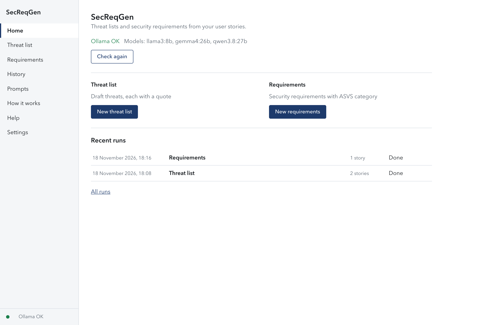
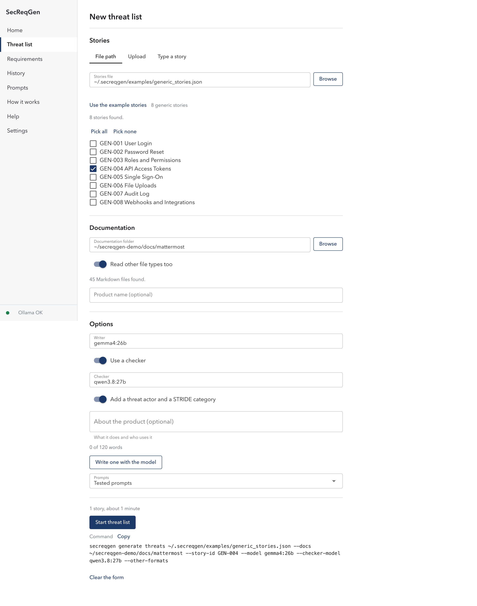
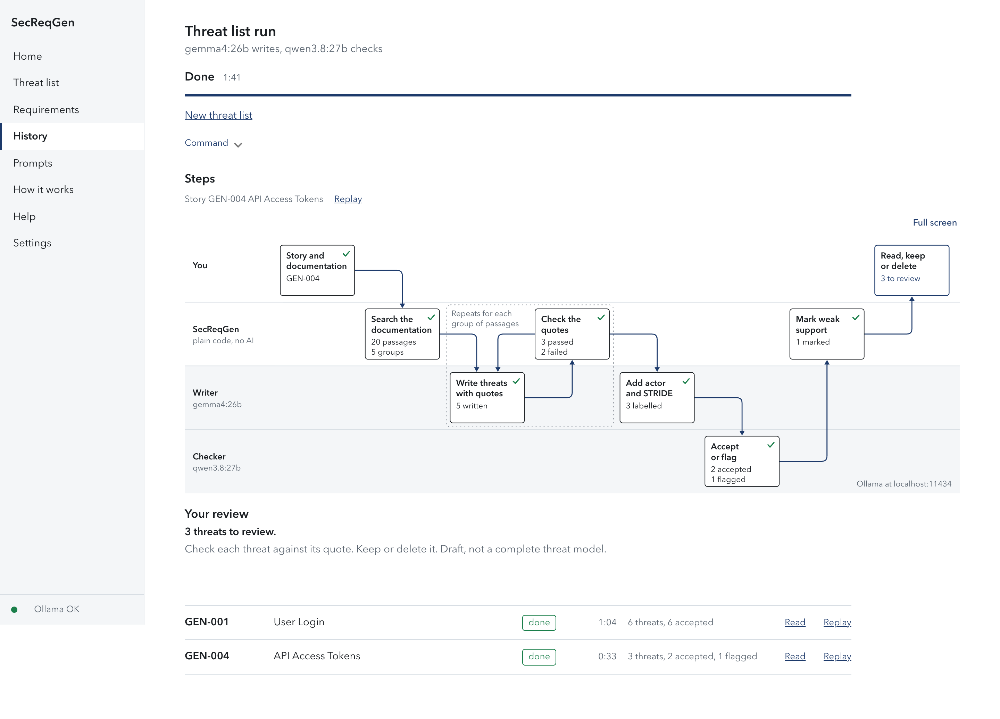
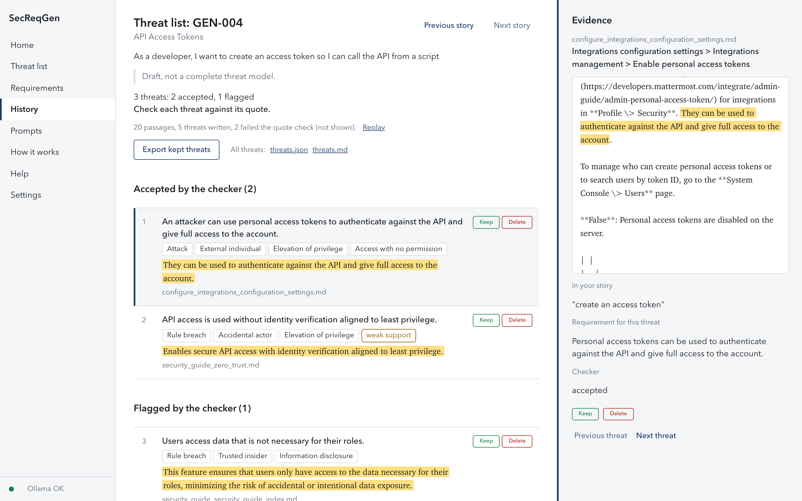
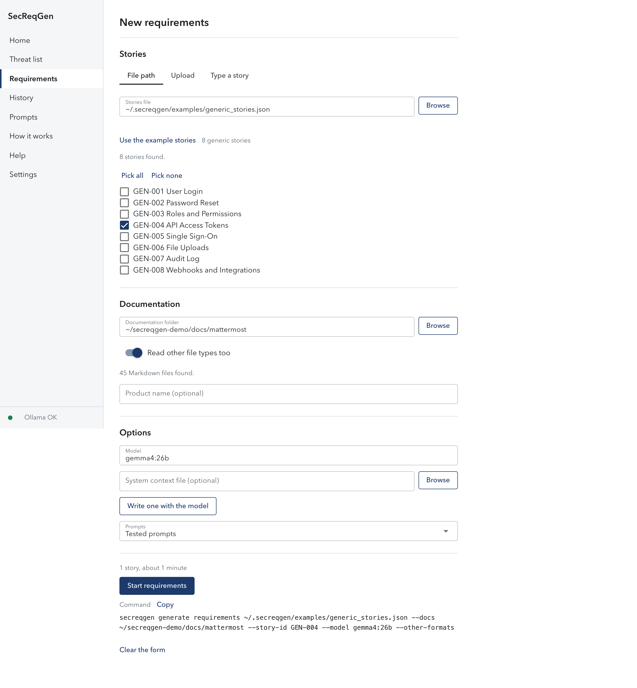
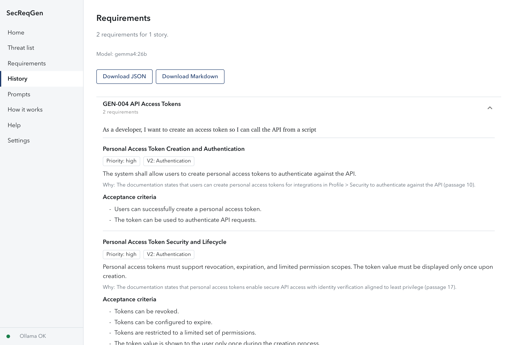
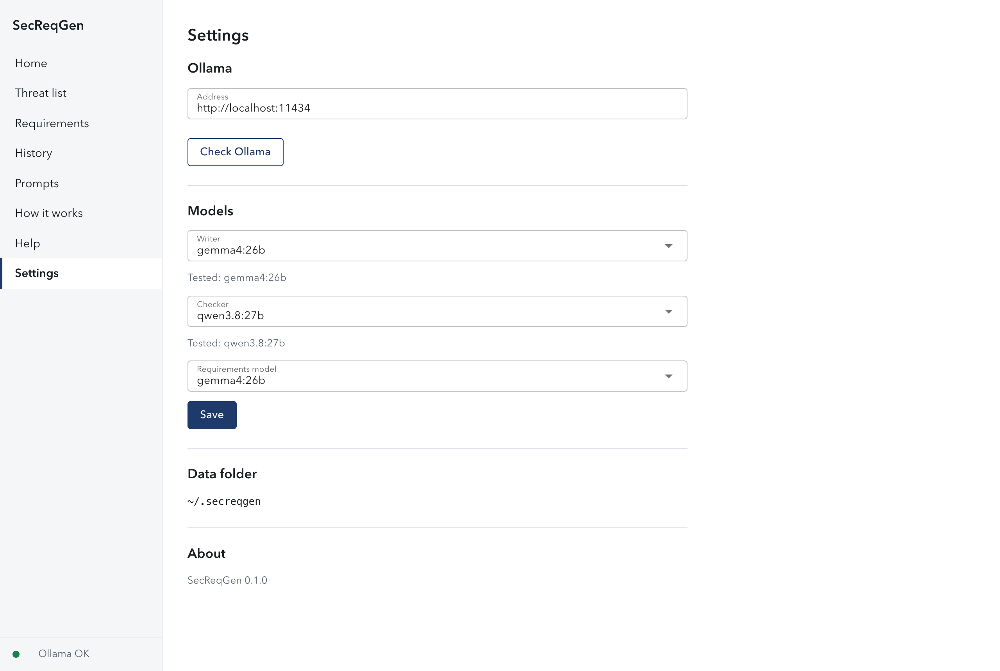

# SecReqGen: user guide

SecReqGen reads the documentation of a product. For each user story it writes security requirements and a draft threat list. Two language models on your own computer do the work, through Ollama: the writer model writes, and the checker model reviews. Each result names the place in the documentation that it comes from, so that you can check it.

Sections 1 to 7 take you through the first run in the GUI. Sections 8 to 13 are for later: your own product, the command line, the settings.

In this guide, "tested" means: the tests of the thesis used it.

## Watch first

1. [The GUI, 1 min 51 s](user_guide/videos/gui_demo.mp4): one requirements run and one threat list run, step by step, with voice.
2. [SecReqGen, 3 min](user_guide/videos/summary.mp4): what the tool is, how it works, and what the tests showed.

Each video has a subtitle file (`.srt`) beside it.

## 1. What you need

- Access to the repository of SecReqGen on GitHub.
- Python 3.13. This is the tested version. The tool also accepts Python 3.11 and 3.12. Python 3.14 is not supported.
- [Ollama](https://ollama.com), running on your computer or on a server that you can reach.
- Two models in Ollama: `gemma4:26b` (the writer) and `qwen3.8:27b` (the checker). This is the tested setup. The two model files are 16 GB and 18 GB. The author runs them on a Mac with 48 GB of memory.
- The documentation of your product as files in one folder. Markdown files (`.md`) are the tested type.

## 2. Install (one time)

Get the code and the packages. The download of the two models takes the most time.

```bash
git clone https://github.com/littleg1105/secreqgen.git
cd secreqgen
python3.13 -m venv .venv
.venv/bin/pip install --no-deps -r requirements-tested.txt
.venv/bin/pip install -r requirements-gui.txt
ollama pull gemma4:26b
ollama pull qwen3.8:27b
```

Check the install:

```bash
export PYTHONPATH=src TOKENIZERS_PARALLELISM=false
.venv/bin/python -m secreqgen generate check-ollama
```

`PYTHONPATH=src` tells Python where the code of the tool is. Run the `export` line again in each new terminal.

## 3. Start the GUI

```bash
export PYTHONPATH=src TOKENIZERS_PARALLELISM=false
.venv/bin/python -m secreqgen_gui
```

Open `http://127.0.0.1:8080` in a browser. The page "Home" shows the state of Ollama and the models that Ollama has.

| Home shows | Do this |
|---|---|
| Ollama OK | Nothing. You can start. |
| Ollama is not running at ... | Start Ollama (open the app, or run `ollama serve`). Then click "Check again". |
| Not in Ollama: a model name | Run the `ollama pull` command that the line shows. Then click "Check again". |



## 4. Your first threat list

1. Open "Threat list" in the menu.
2. Under "Stories", on the tab "File path", click "Use the example stories". The GUI comes with 8 general stories. Tick one story for the first run.
3. Under "Documentation", click "Browse" and pick the folder with the documentation of your product. The line under the field shows how many Markdown files the search will read.
4. Leave the other fields as they are. "Product name" is optional. The switch "Read other file types too" is on: with Markdown files only, it changes nothing.
5. Click "Start threat list". The line above the button shows the expected time.



## 5. The run page

Wait. The page changes by itself. It shows the steps of the story that runs now. A check mark shows that a step is done.

The four lanes are: you, SecReqGen (plain code, no AI), the writer model and the checker model. A passage is a section of a documentation file.

| Step | Who does it | What happens |
|---|---|---|
| Search the documentation | SecReqGen | A word search finds the passages that fit the story |
| Write threats with quotes | The writer | It writes threats. Each threat must copy a statement of a passage as its quote (60 words at most). |
| Check the quotes | SecReqGen | A threat stays only if its quote is in its passage. The check ignores capital letters, spacing and Markdown marks. |
| Add actor and STRIDE | The writer | It names a threat actor and a STRIDE category for each threat |
| Accept or flag | The checker | It reads each threat with its passage, and accepts it or flags it |
| Mark weak support | SecReqGen | A script marks a threat that shows a sign of weak support. Two examples: the quote has 5 words or fewer, or the threat uses words that are not in the passage and not in the story. |
| Read, keep or delete | You | You check each threat |

STRIDE is a list of six kinds of threat: spoofing, tampering, repudiation, information disclosure, denial of service and elevation of privilege.

"Stop after this story" ends the run after the story that runs now. When a story is done, click "Read" in its row at the bottom of the page.



## 6. Read a threat list



- The threats that the checker accepted come first. The flagged threats come after them. The checker and the mark "weak support" remove nothing.
- A threat that failed the quote check is not in the list. The line above "Export kept threats" shows how many failed.
- Each threat shows its tags. "Attack" means that the documentation describes an attack. "Rule breach" means that the documentation states a security rule, and the threat is that someone breaks it. The next tags are the threat actor, the STRIDE category and the harm. The tag "weak support" is a warning.
- The yellow text is the quote from the documentation. The line under it is the file of the quote.
- Click a threat. The right side shows the evidence: the passage with the quote, the part of your story that it fits, the requirement for this threat, and the answer of the checker.
- Click "Keep" or "Delete" for each threat. "Export kept threats" saves the threats that you kept.
- `threats.json` and `threats.md` hold all threats of the story.

The list is a draft for a person to check. It is not a complete threat model: it holds only what your documentation says. In the thesis test of 17 November 2026, 7 of 61 accepted threats were wrong. Flagged threats and threats with weak support were wrong more often. Check each threat against its quote.

## 7. Requirements

1. Open "Requirements" in the menu.
2. Pick the stories and the documentation folder, as in section 4.
3. The field "System context file" is optional. Skip it for the first run.
4. Click "Start requirements".



The result page shows the requirements of each story. A requirement has a priority, an OWASP ASVS category, its text, the reason ("Why"), acceptance criteria and its sources. OWASP ASVS is a public list of security requirements for applications. "V2: Authentication" is one of its chapters. The page also shows the passages that the model read. "Download JSON" and "Download Markdown" save the result.



Check each requirement against its sources.

## 8. Your own product

### Stories

A stories file is a JSON or YAML file (`.json`, `.yaml`, `.yml`) with a list named `user_stories`. Each story needs `story`. Optional fields: `id`, `title`, `acceptance_criteria` (a list). Optional at the top: `project`, the name of the product.

```json
{
  "project": "Mattermost",
  "user_stories": [
    {
      "id": "MM-US-007",
      "title": "Bot and integration setup",
      "story": "As an admin, I want to create a bot account, so that a script can post messages.",
      "acceptance_criteria": ["The bot has a token", "An admin can disable the bot"]
    }
  ]
}
```

With no file, use the tab "Upload" or the tab "Type a story".

### Documentation folder

Pick the folder with the Markdown files (`.md`) of the product. The tool also reads its subfolders.

With the switch "Read other file types too", the search also reads `.rst`, `.adoc`, `.asciidoc`, `.txt`, `.mdx`, `.markdown`, `.html`, `.htm`, `.pdf` and `.docx` files. The GUI converts them in a copy. Your folder does not change.

### System context (requirements, optional)

A system context is a YAML file that describes the product: its parts, its technologies, its kinds of data. If you have none, click "Write one with the model", pick the folder of the codebase and click "Write". The model writes a draft. Check each line against its source, change what is wrong, and click "Save and use".

### About the product (threat list, optional)

One paragraph of 120 words at most: what the product does and who uses it. It is background for the writer. It is not a source: each threat still needs a quote. With "Write one with the model", a model writes facts from the folder of a codebase, and SecReqGen joins them into the paragraph. Check each line, then click "Use this paragraph".

### Tags on a run

A tag on a run means that the run used an option that the thesis tests did not use.

| Tag | When a run gets it |
|---|---|
| untested file types | The run converted one or more files that are not Markdown |
| generated context | The system context came from "Write one with the model" |
| generated paragraph | The paragraph "About the product" came from "Write one with the model" |
| untested prompts | The run used a prompt set of your own (page "Prompts") |

## 9. The command line

Under the Start button, the block "Command" shows the command that starts the same run in a terminal. It changes with each option that you change. Click "Copy" and paste it into a terminal.

```bash
secreqgen generate threats ~/.secreqgen/examples/generic_stories.json --docs ~/product/docs --story-id GEN-004 --model gemma4:26b --checker-model qwen3.8:27b --other-formats
```

- The GUI makes the file `generic_stories.json` at its first start.
- `--other-formats` is in the command when the switch "Read other file types too" is on.
- If your terminal does not know the name `secreqgen`, write `.venv/bin/python -m secreqgen` in its place. Run it in the folder of the repository, with `PYTHONPATH=src`.

| Command | What it writes | Where the result goes |
|---|---|---|
| `secreqgen generate threats STORIES --docs FOLDER` | A draft threat list for each story | The folder `threat_lists` in the current folder: one folder for each story, with `threats.md` and `threats.json`. `--output` changes the folder. |
| `secreqgen generate requirements STORIES --docs FOLDER` | Requirements for each story | The screen. Add `--format json --output FILE` for a file. |
| `secreqgen generate context FOLDER` | A draft system context for a codebase | The screen. Add `--output FILE` for a file. |
| `secreqgen generate about SOURCE` | A draft paragraph about the product | The screen. Add `--output FILE` for a file. |
| `secreqgen generate check-ollama` | Nothing. It checks Ollama and the model. | The screen |

`secreqgen generate threats --help` shows all options of a command. `README.md` explains each option.

## 10. Settings, runs and data



- "Settings" holds the address of Ollama, the writer model, the checker model and the requirements model. It shows the data folder.
- "History" lists all runs. You can open a run again or delete it.
- "Prompts" shows the tested prompt sets. They are locked. You can copy a set and change the copy.
- "How it works" plays the steps of a finished story again.
- "Help" holds the main instructions in short form.
- The data folder is `.secreqgen` in your home folder. It holds the runs, the uploads, your prompt sets and the values of the forms. To use a different folder, set the variable `SECREQGEN_GUI_HOME` before the start. To use a different port, set `SECREQGEN_GUI_PORT`.

## 11. Privacy and safety

- The stories, the documentation and the code go to one place only: the Ollama address of "Settings". The default is your own computer.
- The GUI has no login. It listens on `127.0.0.1`, so only your computer can reach it. Do not change this.
- "Write one with the model" skips secret files by their name (for example `.env` and key files) and hides values that look like secrets. This lowers the risk. It is not a proof that no secret reaches the model.

## 12. Problems

| Problem | Fix |
|---|---|
| Home shows "Ollama is not running at ..." | Start Ollama. Then click "Check again". |
| Home shows "Not in Ollama: ..." | Run the `ollama pull` command of that line. |
| `secreqgen: command not found` | Write `.venv/bin/python -m secreqgen` in place of `secreqgen`. |
| `No module named secreqgen` | Run `export PYTHONPATH=src` in the folder of the repository. |
| The form shows "No documentation files in this folder." or "No Markdown files." | Pick the folder that holds the documentation files. For files that are not Markdown, switch on "Read other file types too". |
| The port 8080 is in use | Start the GUI with `SECREQGEN_GUI_PORT=8090` in front of the command. |
| A run shows "The GUI closed before this run finished." | Start a new run. |
| A threat list has no threats | The documentation has no statement that fits the story. Try a story that the documentation covers. |

## 13. Read more

- `README.md`: each command and each option, the settings, the limits.
- `src/secreqgen_gui/README.md`: the GUI in detail.
- The pages "Help" and "How it works" in the GUI.
