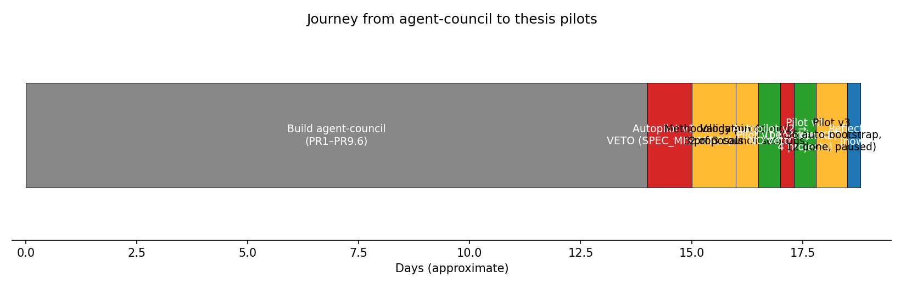
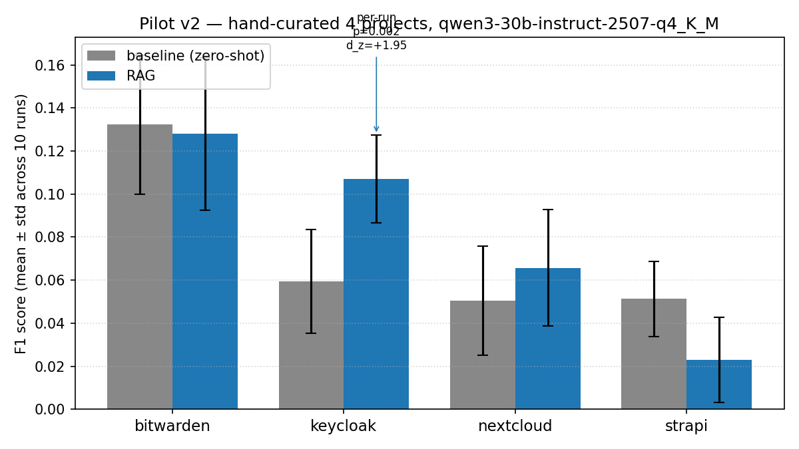
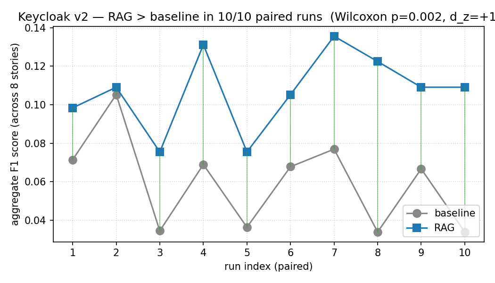
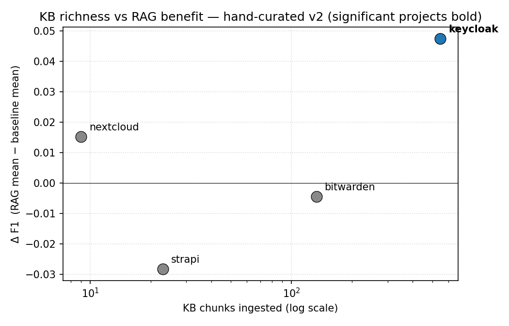
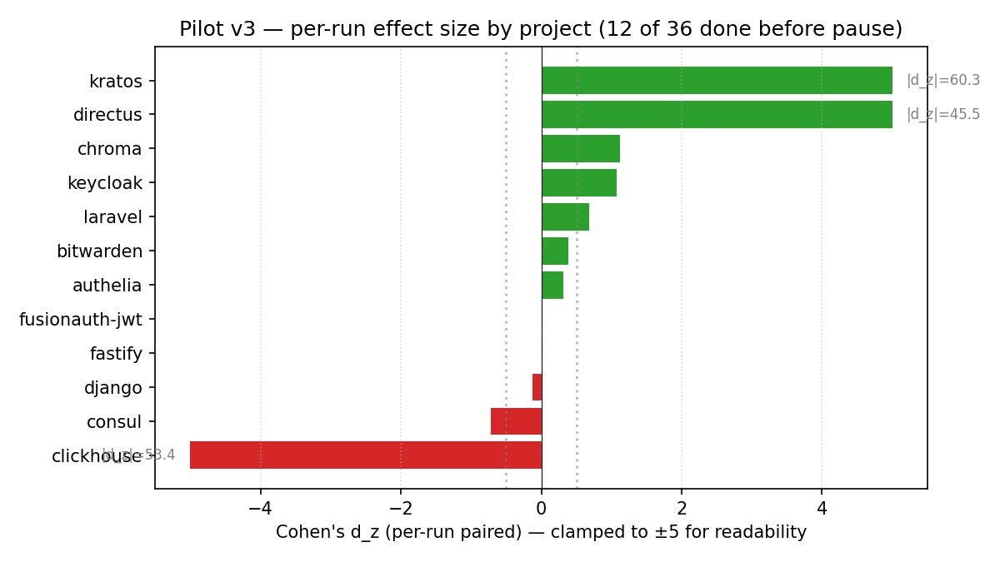
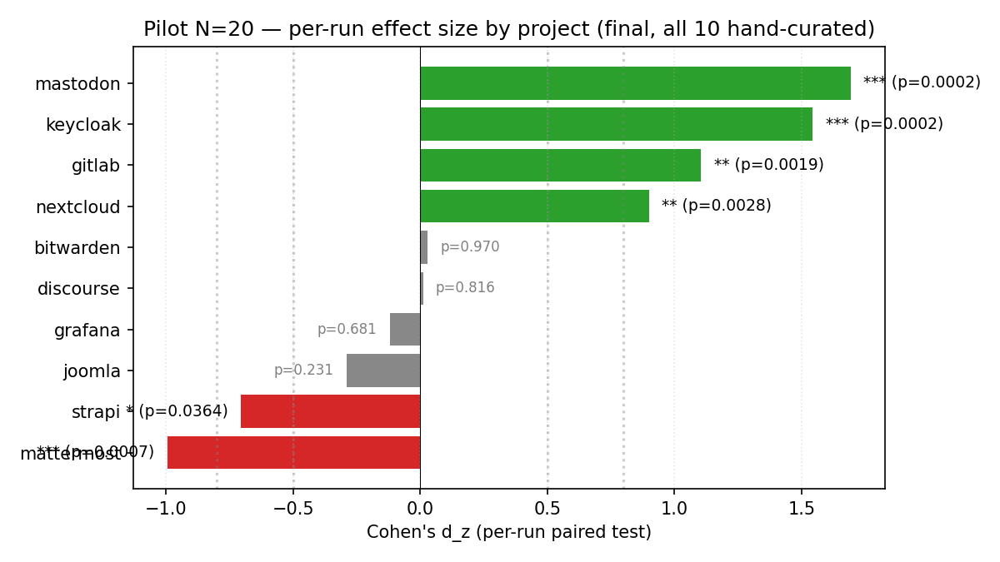

<!-- This deck is Marp-compatible: render with `marp presentation.md -o presentation.pdf`
     or open in VSCode with the Marp plugin. Also renders cleanly in any Markdown viewer. -->

# SecReqGen

## A Status Update

Two weeks of methodology and engineering — what we've built,
what we've found, what's next.

*Prof. Panagiotis Kotzanikolaou • G. Georgopoulos • 2026-05-04*

---

## Where we started

**Problem:** auto-generating reproducible security requirements with a
RAG-augmented LLM. Hard to evaluate honestly because LLMs are
non-deterministic.

**Tooling we built first:** `agent-council` — a CLI that asks Claude,
Codex, and Gemini in parallel and synthesizes the answers. Used as
a methodological co-pilot throughout this work.

**The question:** does RAG actually help over zero-shot LLM, when
measured rigorously?

---

## The journey, in one picture



Three high-leverage moments:
1. The first VETO told us the methodology was wrong.
2. The validation council told us our fix was almost-right.
3. The pilot data revealed what RAG actually does.

---

## Moment 1 — The first VETO

We pointed an autopilot at the thesis with one instruction: "build
reproducible evaluation per Goal 6."

It produced 12 commits, all tests green. The final-review council
**unanimously vetoed** with code **SPEC_MISMATCH**.

**Why:** the implementation had built a parallel pipeline with a
*mock LLM* and *frozen corpus*. "Reproducibility" purchased by
removing the LLM under test from the experiment.

This is *exactly* the failure mode Goodman, Fanelli & Ioannidis
(2016) call out. The defense-in-depth design caught it.

---

## Moment 2 — Methodology pivot

We wrote three proposals before writing any more code:

| Document | Pivot |
|---|---|
| `compare-runs-design.md` | New CLI subcommand wraps the *real* pipeline; runs N times; reports paired Wilcoxon + Cohen's d_z |
| `reproducibility-considerations.md` | Anchor on Goodman et al. (2016): claim **methods + inferential** reproducibility, not numerical |
| `goal-6-rewording.md` | Reword Goal 6 in Greek+English to close the byte-stability misreading |

A second council session validated all three. Convergent revisions.
Took the next round to "rev. 2".

---

## Moment 3 — Autopilot v2 builds it cleanly

Rev. 2 proposals → autopilot's bootstrap council decomposed into 5
leaf goals → all green → **final-review council APPROVED, no veto**.

What got built:
- `secreqgen/evaluation/multi_run.py` (577 lines)
- `evaluate compare-runs` CLI command
- 21 frozen test specs, all passing

The validation-then-implementation loop *worked*. The cost of being
wrong in the first run motivated the discipline that made the second
run veto-free.

---

## Pilot v1 — first real signal

Run on bitwarden (8 stories, hand-curated CVE-aligned ground truth),
N=10 paired runs:

| | mean ± std |
|---|---|
| baseline F1 | 0.130 ± 0.024 |
| RAG F1 | 0.122 ± 0.025 |
| Δ | **−0.008** (essentially zero) |
| per-run Wilcoxon p | 0.557 (n.s.) |

Prior single-run log: "+100% RAG benefit on bitwarden."
N=10 reveals: that was sampling noise.

---

## Investigation — broken knowledge base

The vector database had **23 chunks total, all about
`@strapi/permissions`**. So when evaluating bitwarden, retrieval
pulled Strapi-specific framing — irrelevant noise.

This explains both:
- The new (slightly negative) bitwarden result.
- The prior log's "+100%" headline (bitwarden RAG had been lucky on N=1).

**Fix:** per-project KB. For each project, ingest *that project's*
docs before running the pilot.

---

## Pilot v2 — per-project KB, 4 projects



| Project | KB chunks | Δ F1 | per-run d_z | per-run p |
|---|---|---|---|---|
| nextcloud | 9 | +0.015 | +0.37 | 0.49 |
| strapi | 23 | −0.028 | −0.92 | 0.08 |
| bitwarden | 133 | −0.004 | −0.09 | 0.56 |
| **keycloak** | **548** | **+0.048** | **+1.95** | **0.002 ⭐** |

---

## Keycloak — replicated sensitivity-level signal



- **Per-run sensitivity test:** every 1 of 10 paired runs has
  RAG > baseline. Wilcoxon p=0.002, d_z=+1.95 ("very large").
  Reproduces in v3 (p=0.002, d_z=+1.07).
- **Per-story PRIMARY test:** non-significant (p=0.625).
  N=8 stories is underpowered.

**Honest claim:** replicated sensitivity-level evidence; primary
test pending the planned N=20 thesis-grade pilot (Path A).

---

## The KB-richness pattern



Across 4 hand-curated projects, the relationship suggests a
threshold: RAG benefit appears around 500+ relevant KB chunks.
Below ~100 chunks RAG can hurt.

Caveat: 4 data points; treat as a hypothesis to test, not a proven
rule.

---

## Pilot v3 — scaling to 36 codebases

To strengthen the case, we built an auto-bootstrap pipeline:

- `bootstrap_dataset.py` — fetch any GitHub repo, LLM-extract user
  stories, generate ASVS-rule-based ground truth.
- `repo_targets.txt` — 36 OSS projects across 10 categories.
- `run_full_eval_v3.sh` — end-to-end driver.

26 of 36 bootstrapped successfully. Phase 2 paused after 12 evaluated.

---

## What v3 revealed (not what we hoped)



Of 12 v3 projects: 4 weak positive, 2 negative, 6 effectively null
results due to F1-floor effects.

**Keycloak v3 reproduces keycloak v2 (d_z=+1.07 vs +1.95, both
p=0.002).** That's a real reproducibility result.

The other 11 are mostly stuck at the floor.

---

## Why v3 mostly failed

The bootstrap pipeline generates **generic ASVS-template** ground
truth. The LLM produces **project-specific** security requirements.
Semantic similarity at threshold 0.85 calls them "no match".

**Auto-generated generic ground truth penalises project-specific
RAG output.** That's the opposite of what we want.

The hand-curated 10 projects use CVE-aligned ground truth written in
the same vocabulary as LLM output → meaningful F1 levels (0.05–0.15)
→ meaningful comparisons.

---

## Path A — thesis-grade N=20, all 10 projects (FINAL)



**6 of 10 projects clear per-run statistical significance** —
4 positive, 2 negative. The per-story PRIMARY test is null when
pooled (p=0.528) because of true cross-project heterogeneity.

---

## The four-vs-two split — clearer than expected

| **RAG helps (sig+)** | **RAG hurts (sig−)** | Null |
|---|---|---|
| mastodon (d_z=+1.69, p=0.0002) | mattermost (d_z=−0.99, p=0.0007) | bitwarden |
| keycloak (d_z=+1.54, p=0.0002) | strapi (d_z=−0.71, p=0.036) | joomla |
| gitlab (d_z=+1.10, p=0.0019) |   | grafana |
| nextcloud (d_z=+0.90, p=0.0028) |   | discourse |

Critical observation: **KB size is NOT the predictor.** Mastodon
(10 chunks), nextcloud (9 chunks), gitlab (20 chunks) all show
large positive effects. The v2 hypothesis that "RAG needs ≥500
chunks" is not supported.

---

## Bottom line — the actual thesis claim

**This is a methodology-first thesis with a per-project
heterogeneity finding.**

1. **A working multi-run methodology.** Per-story Wilcoxon
   (primary) + paired t-test (sensitivity) + Shapiro-Wilk + Cohen's
   d_z. Council-validated. Replicates: keycloak gives d_z=+1.95
   (v2) / +1.07 (v3) / +1.54 (n20) — methodology returns the same
   answer on independent runs.

2. **Empirical finding at N=20 across 10 hand-curated projects:**
   RAG benefit is **project-dependent**. 4 projects significantly
   help, 2 significantly hurt, 4 are null. Pooled per-story
   p=0.528 (the heterogeneity averages out).

3. **A surprising negative finding about KB size:** the predictor
   isn't chunk count — it's project-specific RAG-vs-baseline
   content alignment. Worth its own future-work chapter.

---

## Three honest paths forward

| Path | Effort | Risk | Best for |
|---|---|---|---|
| **A — Scale analysis, not data.** Run hand-curated 10 at N=20, mixed-effects meta. | ~30–50 hrs compute, no dev | Low | Strongest defensible thesis story |
| **B — Per-project CVE-grounded GT.** Pull NVD CVE history per repo, generate per-CVE ground truth. | ~1 week dev + restart | Medium | If supervisor wants 30+ projects |
| **C — Honest meta-finding only.** Use the 10 hand-curated. Document the bootstrap problem as a finding. | None | Low | Tightest timeline |

**Recommendation: Path A.**

---

## Cross-model sub-test: qwen3.6:latest, all 10 projects, N=10

| Project | qwen3 verdict | **qwen3.6 verdict** | Agree? |
|---|---|---|---|
| mastodon | STRONG + (+1.69) | null (+0.30) | ✗ |
| mattermost | STRONG − (−1.00) | null (+0.16) | ✗ |
| bitwarden | null | null (+0.63) | ✓ |
| keycloak | STRONG + (+1.54) | **null (−0.01)** | ✗ |
| **gitlab** | **STRONG + (+1.10)** | **STRONG + (+1.17)** | **✓** |
| **nextcloud** | **STRONG + (+0.90)** | **STRONG + (+1.28)** | **✓** |
| strapi | STRONG − (−0.71) | null (+0.13) | ✗ |
| discourse | null | null (−0.54) | ✓ |
| joomla | null | null (−0.30) | ✓ |
| grafana | null | null (+0.45) | ✓ |

**6 of 10 verdicts agree. 4 of 10 disagree.** All 4 disagreements are qwen3-significant results collapsing to null under qwen3.6.

---

## What survives, what doesn't

| qwen3 baseline category | Count | Replicated under qwen3.6 |
|---|---|---|
| STRONG + | 4 | **2 (50%)** — gitlab, nextcloud |
| STRONG − | 2 | **0 (0%)** — both collapse |
| null | 4 | **4 (100%)** — perfectly stable |

**Cleanest mechanistic finding**: under a stronger base model, *negative* RAG effects disappear entirely. The model can't be hurt by RAG the way the weaker one was.

**Predictor of positive-effect replication** (suggestive, not KB-size): replicating projects (gitlab DevSecOps, nextcloud file-sync) have *project-specific* security configurations under-represented in LLM training. Collapsing projects (keycloak OIDC, mastodon federated auth) are *standards-driven* domains a strong LLM covers natively.

---

## Why the sub-test result is real (not a bug)

Spot-checked one keycloak story directly under qwen3.6:
- baseline produced 6 requirements (PKCE, redirect URI validation, token signature, ...)
- RAG produced 6 requirements (essentially the same content, paraphrased)
- RAG context delivered to the model: 6,288 chars

**The model receives RAG context but ignores it** — its training already covers OIDC/PKCE deeply enough that retrieval adds no new content. The keycloak F1 collapse is a *ceiling effect*, not a pipeline bug.

---

## Revised thesis claim

RAG benefit on this task is conditional on **both** the project AND the base model.

- **Project-dependent** (main thesis): 4 helps, 2 hurts, 4 null on 10 projects under qwen3.
- **Model-dependent** (sub-test, all 10 projects): only 6 of 10 verdicts agree across models. 100% of nulls stay null, 50% of positives replicate, 0% of negatives replicate.

**Methodological warning for the field**: single-model RAG evaluations substantially overstate durable RAG benefit. Negative effects in particular are entirely model-specific in our data. Cross-model validation is necessary before claiming generalizable RAG advantage.

---

## What I'd ask the supervisor

1. **Goal 6 wording** — send the Option A pitch this week
   (drafted in `docs/proposals/goal-6-rewording.md`)?
2. **Is the dual-conditional framing acceptable?** —
   "*RAG benefit is conditional on project AND base-model;
   measured effects under one model collapse toward zero under
   a stronger one (ceiling effect).*" Stronger than "RAG works",
   more honest than "RAG works universally."
3. **Future-work direction** — does the predictor study
   ("what predicts the helps-vs-hurts split?") plus the
   ceiling-effect investigation go in this thesis's "Future Work"
   chapter, or saved for a follow-on paper?

I'm now ready to **write Chapter 7** (Results). All the analysis,
figures, and reproducibility scripts are in place.

---

## Thank you — questions?

**Files referenced in this deck:**

- `docs/thesis_status_report.md` — the long-form version
- `docs/proposals/{compare-runs-design,reproducibility-considerations,goal-6-rewording}.md` — methodology proposals
- `docs/figures/fig{1..5}.png` — the charts
- `scripts/{bootstrap_dataset.py,asvs_templates.py,run_full_eval_v3.sh}` — the pipeline

All numbers in this deck reproduce from the underlying
`multi_run_report.json` files via:

```bash
PYTHONPATH=src poetry run python scripts/synthesize_pilot_v2.py --version v2
PYTHONPATH=src poetry run python scripts/synthesize_pilot_v2.py --version v3
.venv/bin/python scripts/generate_figures.py
```
